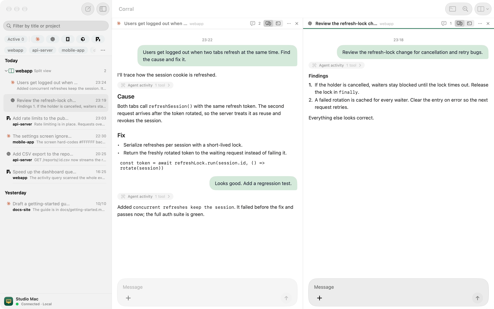
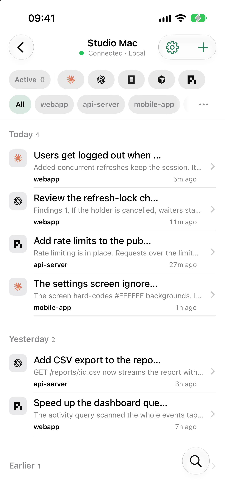
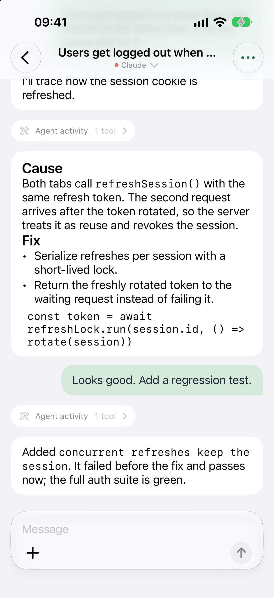

**Languages:** English | [简体中文](README.zh-CN.md)

<p align="center"></p>
<h1 align="center">Corral for iPhone and Mac</h1>
<p align="center"><strong>Keep your coding agents moving, wherever you are.</strong></p>

Read replies, answer questions, and send the next instruction to Claude Code, Codex, OpenCode, Cursor, or Pi from a native Apple client. Your agents run on a [Corral host](https://github.com/corral-dev/corral) on macOS or Linux.

- **See who needs you.** Follow all five assistants in one session list.
- **Work across sessions.** Open up to four panes side by side on Mac.
- **Choose your view.** Switch each Mac pane between chat and the agent's terminal.
- **Find your work.** Filter by project and search conversation text.
- **Keep typing.** Use keyboard shortcuts on Mac, or reply from your iPhone.

<p align="center">
  <picture>
    <source media="(prefers-color-scheme: dark)" srcset="docs/screenshots/mac-split-dark.png">
    
  </picture>
</p>

<p align="center">
  <picture>
    <source media="(prefers-color-scheme: dark)" srcset="docs/screenshots/iphone-sessions-dark.png">
    
  </picture>
  <picture>
    <source media="(prefers-color-scheme: dark)" srcset="docs/screenshots/iphone-chat-dark.png">
    
  </picture>
</p>

## Install

The **Mac app** is a signed download. The **iPhone app** is a source beta: build it with Xcode. Public App Store and TestFlight downloads are not available yet.

| Client | Requirements |
| --- | --- |
| Mac | macOS 26+ (building from source also needs Xcode with the macOS 26 SDK) |
| iPhone | iOS 17+, Xcode, your own signing team and a physical iPhone |
| Host | [Corral CLI](https://github.com/corral-dev/corral#install) on macOS or Linux, with an installed coding assistant |

### Mac

Install the signed Mac app with Homebrew:

```bash
brew install --cask x0c/tap/corral-mac
```

Already installed the official DMG? Register it with Homebrew:

```bash
brew install --cask --adopt x0c/tap/corral-mac
```

Open Corral from Applications. Once registered, update with:

```bash
brew update
brew upgrade --cask x0c/tap/corral-mac
```

<details>
<summary>Troubleshooting Homebrew updates</summary>

Note: Corral also includes a built-in auto-updater. If `brew install` reports that `Corral.app` already exists in `/Applications`, run `brew install --cask --adopt x0c/tap/corral-mac` instead of `--force`. Pairing and settings are preserved. [How Homebrew handles self-updating apps](https://docs.brew.sh/FAQ#how-does-brew-upgrade-handle-apps-that-update-themselves).

</details>

Download the [signed Mac DMG](https://github.com/corral-dev/corral-apple/releases/latest) and drag Corral to Applications. It checks for updates hourly, downloads them in the background and installs them when you quit.

To build from source instead, with Xcode and its command-line tools installed:

```bash
curl -fsSL https://raw.githubusercontent.com/corral-dev/corral-apple/main/install.sh | bash
```

Open Corral from `~/Applications`. To choose another installation directory, set `CORRAL_APP_DIR` when running the installer.

### iPhone

Install [XcodeGen](https://github.com/yonaskolb/XcodeGen), then clone the source and generate the Xcode project:

```bash
git clone https://github.com/corral-dev/corral-apple.git
cd corral-apple
xcodegen generate
```

Open `Corral.xcodeproj`, choose your own team and unique bundle identifiers, and build for your iPhone. Follow the [build and signing guide](docs/PUBLIC_BUILD_GUIDE.md) for the shared Keychain group and notification extension. Push notifications require an Apple Developer membership.

## Pair with your host

On the machine that runs your agents:

```bash
brew install x0c/tap/corral
corral remote pair
```

If Corral is already installed, run only the second command. [Other CLI installation options](https://github.com/corral-dev/corral#install) are available.

On the same local network, open the Apple client and scan or paste the pairing code. Pairing lets the client read and act on your host's sessions; use `corral remote pair --readonly` for viewing only. Keep the code private. The host must remain awake for agents and remote access to keep working.

## Access from another network

Run your own [Corral relay](https://github.com/corral-dev/corral-relay#quick-start) and configure its `wss://` address on the host. Same-network access works directly. Open-source clients use your configured relay; a shared hosted relay is not included.

For iPhone notifications, configure APNs on that relay with credentials matching your own app identity. Without APNs, conversations still update while the client is open.

## Privacy

Session traffic and notification text are end-to-end encrypted. The relay sees routing identities, connection timing and byte counts. Device keys are stored in Keychain; conversations can be cached on the client for reopening history. See [PRIVACY.md](PRIVACY.md).

## Help and contribute

- [Build and signing guide](docs/PUBLIC_BUILD_GUIDE.md)
- [Report a bug or request a feature](https://github.com/corral-dev/corral-apple/issues/new/choose)
- [Contributing](CONTRIBUTING.md) and the [contributor agreement](CLA.md)

Remove private conversations, machine addresses and pairing credentials from public reports. For vulnerabilities, use [private security reporting](https://github.com/corral-dev/corral-apple/security/advisories/new).

## 🧩 Related Tools in the AI Coding Suite

If you run multiple AI coding agents daily, check out the rest of the local-first toolkit:

| Repository | Description |
| :--- | :--- |
| **[corral](https://github.com/corral-dev/corral)** | Run Claude Code, Codex, OpenCode, Cursor & Pi side-by-side in a terminal session manager, then continue from iPhone or Mac. |
| **[subswap](https://github.com/x0c/subswap)** | Check remaining quota and switch Claude Code, Codex, Cursor, Kimi Code & OpenCode accounts without logging out. |
| **[agentsync](https://github.com/x0c/agentsync)** | Sync `AGENTS.md`, `CLAUDE.md`, skills, and MCP configs across coding agents from one local source of truth. |
| **[agent-doc-skills](https://github.com/x0c/agent-doc-skills)** | Navigable project knowledge base skills (`doc-init`, `doc-update`, `doc-compact`) so coding agents don't rediscover your repo every session. |

## License

[GPL-3.0-only](LICENSE). Corral's name and floral-hat artwork have a separate [brand policy](BRAND_POLICY.md). Dependencies and assistant-provider marks retain their own licenses and ownership; see [third-party notices](THIRD_PARTY_NOTICES.md).
