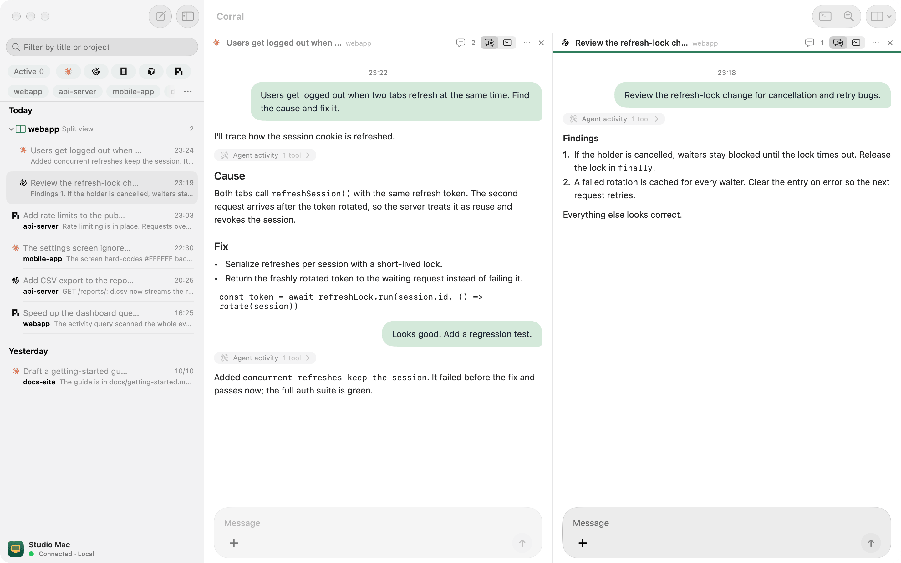
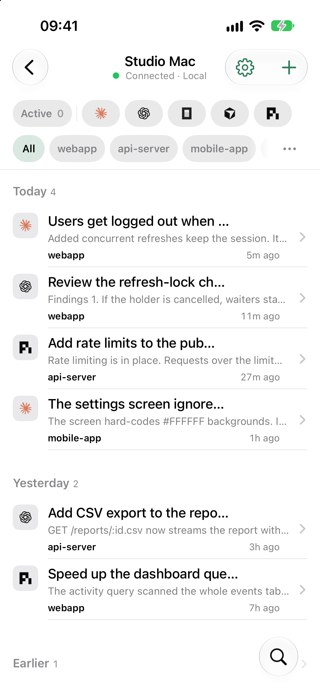
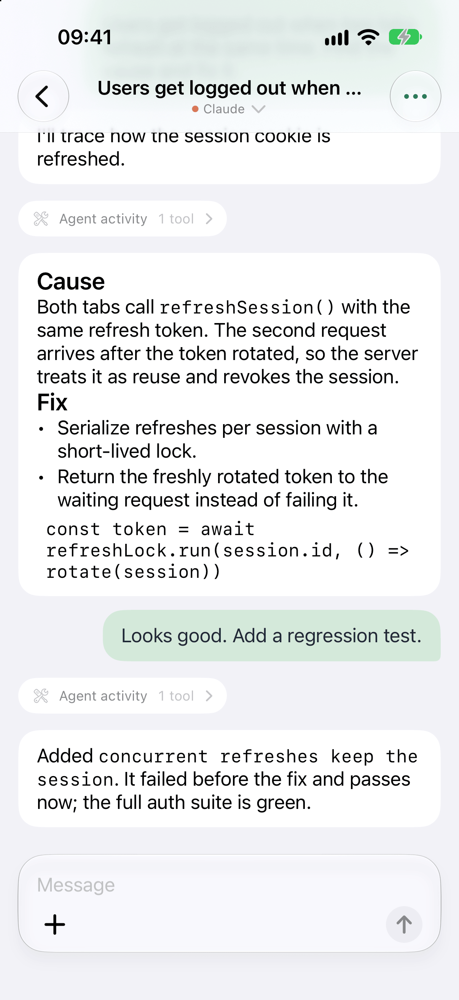

**语言：** [English](README.md) | 简体中文

<p align="center"></p>
<h1 align="center">Corral iPhone 与 Mac 客户端</h1>
<p align="center"><strong>随时跟进编程助手，让任务继续往前走。</strong></p>

通过原生 Apple 客户端实时阅读回复、回答助手提问，并向 Claude Code、Codex、OpenCode、Cursor、Pi 或 Antigravity 发送下一条指令。助手运行在 macOS 或 Linux 上的 [Corral 开发机](https://github.com/corral-dev/corral)。

- **看到谁在等你。** 在同一个会话列表里跟进六种助手。
- **同时处理多个会话。** Mac 上最多四个分屏并排显示。
- **自由切换视图。** 每个 Mac 分屏都可在实时对话视图与助手终端之间切换。
- **快速找到任务。** 按助手或项目筛选，并支持全文搜索对话内容。
- **随手回复。** 在 Mac 上用键盘快捷键操作、排队追问，或直接从 iPhone 回复。

<p align="center">
  <picture>
    <source media="(prefers-color-scheme: dark)" srcset="docs/screenshots/mac-split-dark.png">
    
  </picture>
</p>

<p align="center">
  <picture>
    <source media="(prefers-color-scheme: dark)" srcset="docs/screenshots/iphone-sessions-dark.png">
    
  </picture>
  <picture>
    <source media="(prefers-color-scheme: dark)" srcset="docs/screenshots/iphone-chat-dark.png">
    
  </picture>
</p>

## 安装

**Mac 版**支持 Homebrew Cask 一键安装或下载签名 DMG。**iPhone 版**目前是源码测试版，需使用 Xcode 构建，尚无公开的 App Store 或 TestFlight 下载。

| 客户端 | 要求 |
| --- | --- |
| Mac | macOS 26+（从源码构建还需要带有 macOS 26 SDK 的 Xcode） |
| iPhone | iOS 17+、Xcode、自己的签名团队及一台实体 iPhone |
| 开发机 | 在 macOS 或 Linux 上安装 [Corral CLI](https://github.com/corral-dev/corral#install) 和至少一个编程助手 |

### Mac

通过 Homebrew 安装已签名的 Mac 客户端（会自动一并安装匹配的 `corral` CLI）：

```bash
brew install --cask x0c/tap/corral-mac
```

也可以直接下载[已签名的 Mac DMG](https://github.com/corral-dev/corral-apple/releases/latest)，把 Corral 拖进「应用程序」。

Mac 客户端与 CLI 保持版本号同步：应用在启动与内置更新后会自动安装或同步匹配版本的 Corral CLI（不会覆盖开发者源码安装）；通过 `corral update` 升级 CLI 时也会同步更新 `/Applications/Corral.app`。内置更新每小时检查一次，后台下载并在退出时安装。

<details>
<summary>已通过 DMG 安装，或使用 Homebrew 升级</summary>

将已安装的 `/Applications/Corral.app` 登记到 Homebrew：

```bash
brew install --cask --adopt x0c/tap/corral-mac
```

登记后用以下命令升级：

```bash
brew update && brew upgrade --cask x0c/tap/corral-mac
```

内置更新仍可与 Homebrew 并存。应用内更新后，Homebrew 登记的版本号偏旧属正常现象；请勿将 `--force` 当作常规修复，以免用旧版覆盖新版应用。配对和设置都会保留。详见 [Homebrew 对应用内更新的处理](https://docs.brew.sh/FAQ#how-does-brew-upgrade-handle-apps-that-update-themselves)。

</details>

<details>
<summary>从源码构建</summary>

安装好 Xcode 及其命令行工具后运行：

```bash
curl -fsSL https://raw.githubusercontent.com/corral-dev/corral-apple/main/install.sh | bash
```

从 `~/Applications` 打开 Corral。如需安装到其他目录，运行前设置 `CORRAL_APP_DIR`。

</details>

### iPhone

先安装 [XcodeGen](https://github.com/yonaskolb/XcodeGen)，再克隆源码并生成 Xcode 项目：

```bash
git clone https://github.com/corral-dev/corral-apple.git
cd corral-apple
xcodegen generate
```

打开 `Corral.xcodeproj`，选择自己的签名团队和唯一的应用标识，在 iPhone 上构建运行。共享 Keychain 分组与通知扩展的设置见[构建与签名指南](docs/PUBLIC_BUILD_GUIDE.md)。推送通知需要 Apple Developer 会员资格。

## 与开发机配对

在运行助手的机器上执行：

```bash
brew install x0c/tap/corral
corral remote pair
```

若已安装 Corral，只需执行 `corral remote pair`。也可选择[其他 CLI 安装方式](https://github.com/corral-dev/corral#install)。

在同一局域网内打开 Apple 客户端，扫描或粘贴配对码即可。配对会授权客户端读取并操作开发机上的会话；若只需查看，可使用 `corral remote pair --readonly`。请保密配对码，并保持开发机唤醒。

## 从其他网络访问

自行部署 [Corral 中继](https://github.com/corral-dev/corral-relay#quick-start)，并在开发机配置其 `wss://` 地址。同一局域网内直接连接，无需中继。开源客户端使用你配置的中继，不包含共享托管中继。

若需要 iPhone 推送通知，在中继上配置与自己应用标识匹配的 APNs 凭据。未配置 APNs 时，客户端打开期间仍能实时更新对话。

## 隐私

会话通信和推送正文采用端到端加密。中继只能看到路由标识、连接时间和字节数。设备密钥保存在 Keychain 中；客户端可本地缓存对话，以便重新打开历史记录。详见 [PRIVACY.md](PRIVACY.md)。

## 获取帮助与参与贡献

- [构建与签名指南](docs/PUBLIC_BUILD_GUIDE.md)
- [报告问题或提出功能建议](https://github.com/corral-dev/corral-apple/issues/new/choose)
- [参与贡献](CONTRIBUTING.md)与[贡献者协议](CLA.md)

公开报告前请去除私人对话、机器地址和配对凭据。漏洞请使用[私密安全报告](https://github.com/corral-dev/corral-apple/security/advisories/new)。

## 相关工具

| 仓库 | 说明 |
| :--- | :--- |
| **[corral](https://github.com/corral-dev/corral)** | 面向 Claude Code、Codex、OpenCode、Cursor、Pi 和 Antigravity 的本地优先终端工作区与主机 CLI。 |
| **[corral-relay](https://github.com/corral-dev/corral-relay)** | 自建端到端加密中继与 APNs 推送桥接服务，用于跨网络连接 Corral。 |
| **[subswap](https://github.com/x0c/subswap)** | 查剩余额度，一键切换 Claude Code、Codex、Cursor、Kimi Code 和 OpenCode 账号，不用反复登录。 |
| **[agentsync](https://github.com/x0c/agentsync)** | 以一份本地源统一同步 `AGENTS.md`、`CLAUDE.md`、skills 和 MCP 配置到各编程助手。 |
| **[agent-doc-skills](https://github.com/x0c/agent-doc-skills)** | 可导航的项目知识库 skills（`doc-init`、`doc-update`、`doc-compact`），让编程助手不再每个会话都重新认识你的仓库。 |
| **[sesskit](https://github.com/x0c/sesskit)** | 从磁盘解析并导出 Claude Code、Codex、OpenCode、Cursor、Pi 和 Antigravity 的本地会话记录。 |

## 许可

[GPL-3.0-only](LICENSE)。Corral 名称与花朵牛仔帽图案遵循独立的[品牌政策](BRAND_POLICY.md)。依赖及各助手提供商的标识保留各自的许可与归属，见[第三方声明](THIRD_PARTY_NOTICES.md)。
